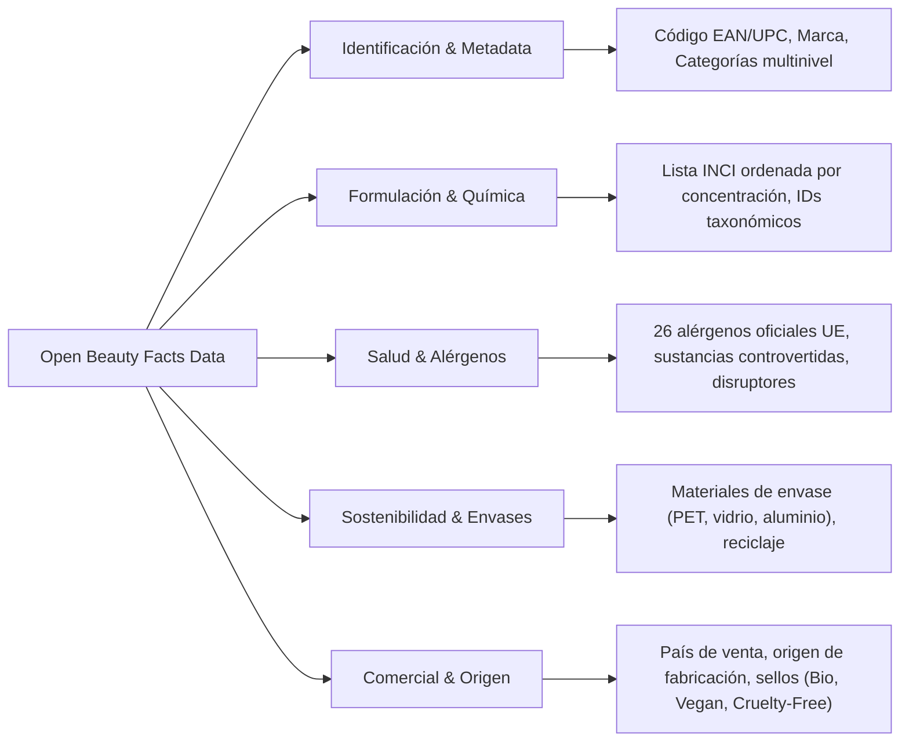

# Ecosistema de Datos de Open Beauty Facts: Casos de Uso, Oportunidades y Startups

> **Objetivo:** Guía integral de explotación de datos abiertos de [Open Beauty Facts](https://world.openbeautyfacts.org/) para hackathons de emprendimiento e innovación. Orientada a la generación de modelos de negocio, productos digitales, análisis de mercado y soluciones de impacto basados en datos cosméticos.

---

## 1. La Materia Prima: ¿Qué Datos Específicos Hay Disponibles?

Open Beauty Facts no es solo un listado de nombres de cremas; es una **base de datos relacional y semiestructurada** con más de **100.000 productos** en más de 170 países. Los datos brutos y procesados incluyen:



### Campos clave explotables:
* **Taxonomía INCI normalizada:** Ingredientes estandarizados con etiquetas normalizadas (permite buscar productos que compartan exactamente los mismos compuestos activos).
* **Posición en la fórmula:** En cosmética, los ingredientes se listan en orden descendente de concentración hasta el 1%. Esto permite saber si el "aceite de argán" es el ingrediente principal o si está en el 0.01% al final de la lista.
* **Marcadores de riesgo y controversia:** Sulfatos (SLS/SLES), siliconas no biodegradables, aceites minerales (parafinas), liberadores de formaldehído, microplásticos y filtros UV controvertidos.
* **Alérgenos regulados:** Mapeo automático de los 26 alérgenos de obligada declaración en la Unión Europea.
* **Componentes del packaging:** Tipo de material (plástico, vidrio, papel, metal) y forma (tubo, tarro, spray, bote con bomba).

---

## 2. Modelos de Negocio y Aplicaciones que se Pueden Construir

A continuación se detallan las grandes oportunidades de producto agrupadas por categoría:

---

### A. Consumer Tech: Salud, Alergias y Rutinas Personalizadas (B2C)

#### 1. "Allergy & Skin Guardian" (Filtro Personalizado de Alérgenos)
* **El Problema:** Millones de personas padecen dermatitis de contacto, rosácea, acné fúngico o alergias a fragancias específicas. Leer etiquetas diminutas en la tienda es frustrante e inseguro.
* **La Solución:** Una app o perfil digital donde el usuario define sus intolerancias (ej. *"alergia al Linalool, intolerancia a sulfatos, piel propensa al acné"*). Al escanear o buscar cualquier cosmético, la herramienta da un veredicto binario instantáneo: **Apto / No Apto**, explicando el porqué.
* **Diferencial:** No una nota genérica del 1 al 100, sino una auditoría 100% personalizada para la condición médica del usuario.

#### 2. "Routine Conflict Checker" (Incompatibilidad de Activos)
* **El Problema:** Los consumidores combinan sérums, tónicos y cremas de distintas marcas sin saber que ciertos principios activos reaccionan negativamente entre sí (ej. Retinol con Ácido Glicólico provoca irritación; Vitamina C pura con Niacinamida a pH inadecuado pierde efectividad).
* **La Solución:** El usuario escanea todos los productos de su neceser. El motor cruza los ingredientes activos y crea un calendario seguro: *"Usa el producto X por la mañana y el producto Y por la noche para evitar dermatitis"*.

#### 3. "Pregnancy & Nursing Safe Scanner"
* **El Problema:** Durante el embarazo y lactancia, ingredientes comunes como retinoides, ciertos aceites esenciales, ácido salicílico en alta dosis o disruptores endocrinos están desaconsejados.
* **La Solución:** Nicho ultra-específico con alta disposición de pago: escáner especializado en seguridad materno-infantil.

---

### B. E-Commerce & Retail: Comparadores y "Dupe Finders"

#### 4. "The Dupe Finder" (Encontrador de Clones Asequibles)
* **El Problema:** Productos de lujo (cremas de 90€, sérums virales de alta gama) tienen costes inflados por marketing y packaging, mientras que existen productos de droguería de 6€ con fórmulas casi idénticas.
* **La Solución:** Algoritmo de similitud vectorial o de solapamiento de ingredientes:
  * El usuario introduce su producto favorito de alta gama.
  * La plataforma busca en la base de datos de OBF los productos que compartan los 5 primeros ingredientes activos y tengan un precio sensiblemente menor.
* **Monetización:** Enlaces de afiliación con Amazon, marketplaces de farmacia o perfumerías online.

#### 5. Extensiones de Navegador para Compras en Línea
* **La Solución:** Extensión para Chrome/Firefox/Safari que se activa al navegar por webs como Amazon, Sephora o Primor.
* **Funcionalidad:** Inyecta directamente en la ficha de producto una pestaña transparente con:
  * ¿Cuántos ingredientes tóxicos o microplásticos tiene?
  * ¿Es realmente vegano o solo marketing?
  * Alternativas mejor formuladas en la misma tienda.

---

### C. Sostenibilidad, Ética y Detección de "Greenwashing"

#### 6. Detector Automatizado de Greenwashing
* **El Problema:** Marcas que utilizan envases verdes, tipografías rústicas y palabras como *"Botánico"*, *"Puro"* o *"Natural"*, pero cuya fórmula contiene derivados del petróleo o conservantes agresivos en los primeros puestos.
* **La Solución:** Un índice de coherencia de marca:
  * Cruza las palabras clave del marketing con la composición real del INCI.
  * Asigna un **"Greenwashing Score"**: alerta cuando los ingredientes botánicos anunciados están por debajo del 1% de concentración.

#### 7. Calculadora de Huella Plástica del Neceser (Circular Economy)
* **El Problema:** La industria cosmética produce más de 120.000 millones de unidades de envases al año, la mayoría no reciclables por estar compuestos de multicapas o bombas con muelles metálicos.
* **La Solución:** Auditoría del baño del consumidor. Escanea su rutina y le muestra:
  * Kilos de plástico no reciclable consumidos al año.
  * Transición guiada hacia cosmética sólida (champús sólidos, pastillas de jabón, envases de aluminio o sistemas *refill*).

---

### D. B2B & Data Intelligence: Soluciones para Marcas y Farmacias

#### 8. Market & Ingredient Trend Intelligence (B2B SaaS)
* **Clientes:** Laboratorios cosméticos, formuladores químicos y marcas emergentes.
* **Propuesta de Valor:**
  * **Análisis de tendencias de ingredientes:** ¿Qué activos están subiendo en adopción (ej. Niacinamida, Péptidos, Centella Asiática, Bakuchiol)?
  * **Monitoreo de sustitución de conservantes:** Analizar a qué velocidad la industria está abandonando ciertos conservantes sintéticos en favor de alternativas naturales.
  * **Análisis de huecos de mercado (White Space Analysis):** Identificar qué categorías de producto carecen de opciones sin fragancia o sin plástico.

#### 9. Enriquecimiento de Catálogos para E-Commerce de Farmacia (Data-as-a-Service)
* **El Problema:** Las farmacias y tiendas online reciben catálogos de proveedores en hojas de cálculo planas sin desglose de atributos (sin saber qué productos son sin gluten, sin sulfatos o aptos para piel atópica).
* **La Solución:** Una API B2B que toma el código EAN del producto, consulta OBF y devuelve etiquetas enriquecidas y normalizadas para alimentar filtros avanzados de búsqueda en el e-commerce del cliente.

---

### E. Inteligencia Artificial: Agentes y Asistentes Conversacionales

#### 10. Agente Dermocosmético con RAG (Retrieval-Augmented Generation)
* **Arquitectura:** Un modelo de lenguaje (LLM) conectado a la base de datos de Open Beauty Facts mediante búsqueda semántica o llamadas a herramientas.
* **Experiencia de Usuario:** El usuario pregunta en lenguaje natural:
  > *"Tengo piel grasa deshidratada, presupuesto de 15€ y vivo en una zona muy seca. ¿Qué limpiador facial que no tenga alcohol denat ni fragancias puedo comprar en el supermercado?"*
* **Resultado:** El agente busca en los 100.000 productos y responde con productos concretos, citando la lista real de ingredientes y su justificación química.

---

## 3. Matriz de Valor: ¿Cómo Elegir una Idea para la Hackathon?

| Proyecto | Complejidad Técnica | Valor para el Pitch | Modelo de Monetización |
| :--- | :--- | :--- | :--- |
| **Dupe Finder** | Media (Algoritmo de similitud) | Muy Alto (Viralidad en redes) | Afiliación (B2C) |
| **Allergy Guardian** | Baja / Media (Lógica condicional) | Alto (Resuelve dolor médico real) | Freemium / Suscripción |
| **Detector de Greenwashing** | Baja (Análisis de texto + INCI) | Muy Alto (Storytelling de impacto) | Donaciones / B2B Certificación |
| **Enriquecedor de Catálogos** | Media (API B2B / ETL) | Alto (Enfoque corporativo B2B) | Suscripción API mensual |
| **Asistente IA con RAG** | Media / Alta (LLM + Vector DB) | Excelente (Tecnológico e innovador) | B2C Pro o Marca Blanca para marcas |

---

## 4. Arquitectura Rápida para Prototipar en la Hackathon

### Opción 1: Prototipo Low-Code (En menos de 4 horas)
1. **Frontend:** Bubble, FlutterFlow o Glide App.
2. **Lógica de Datos:** Escaneo de código de barras nativo en el móvil.
3. **Backend:** Endpoint directo a `https://world.openbeautyfacts.org/api/v0/product/{barcode}.json`.
4. **Respuesta:** Extraer los campos `product.ingredients_text_with_allergens` y `product.allergens_tags` y mostrarlos con colores de alerta en pantalla.

### Opción 2: Pipeline de Datos & Dashboard Analítico (Python / Streamlit)
1. Descargar el volcado de datos comprimido (JSONL o CSV) desde la web de Open Beauty Facts.
2. Limpiar y procesar con `pandas`.
3. Crear un dashboard interactivo en `Streamlit` para visualizar:
   * Los 10 alérgenos más comunes por categoría.
   * La distribución de tipos de plástico por país o marca.
   * La evolución del uso de ingredientes sintéticos.

### Snippet de Ejemplo: Consulta Rápida con Python
```python
import requests

def analizar_producto(codigo_barras: str):
    url = f"https://world.openbeautyfacts.org/api/v0/product/{codigo_barras}.json"
    headers = {"User-Agent": "HackathonProject - InnovationLab - Version 1.0"}
    
    response = requests.get(url, headers=headers)
    if response.status_code != 200:
        return {"error": "Producto no encontrado"}
    
    data = response.json()
    if data.get("status") != 1:
        return {"error": "Sin datos para este código de barras"}
        
    producto = data.get("product", {})
    return {
        "nombre": producto.get("product_name", "Desconocido"),
        "marca": producto.get("brands", "Desconocida"),
        "ingredientes_raw": producto.get("ingredients_text", ""),
        "alergenos": producto.get("allergens_tags", []),
        "sellos": producto.get("labels_tags", []),
        "envase": producto.get("packaging_tags", [])
    }

# Prueba con un código de barras de muestra:
# print(analizar_producto("3017620422003"))
```

---

## 5. Estrategia de Pitch y Narrativa de Negocio

Si presentas un proyecto basado en estos datos ante un jurado de inversores o mentores de startups:

1. **La Validación de los Datos:** "No construimos sobre suposiciones; aprovechamos un ecosistema abierto con más de 100.000 productos auditados a nivel mundial."
2. **Efecto Red & Crecimiento Orgánico:** "Al beber de una base colaborativa abierta, nuestro catálogo crece automáticamente sin necesidad de pagar costes exorbitantes de adquisición de datos iniciales."
3. **El 'Moat' (Ventaja Competitiva):** "La base de datos es pública, pero **nuestro valor diferencial es la capa de inteligencia**: el algoritmo de similitud, el diagnóstico médico personalizado o la interfaz conversacional que traduce la jerga química para el usuario final."
