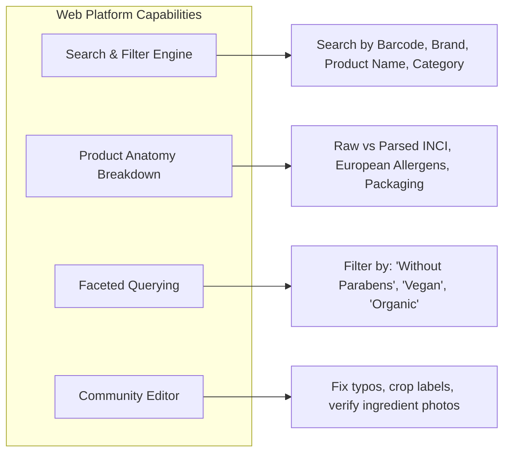
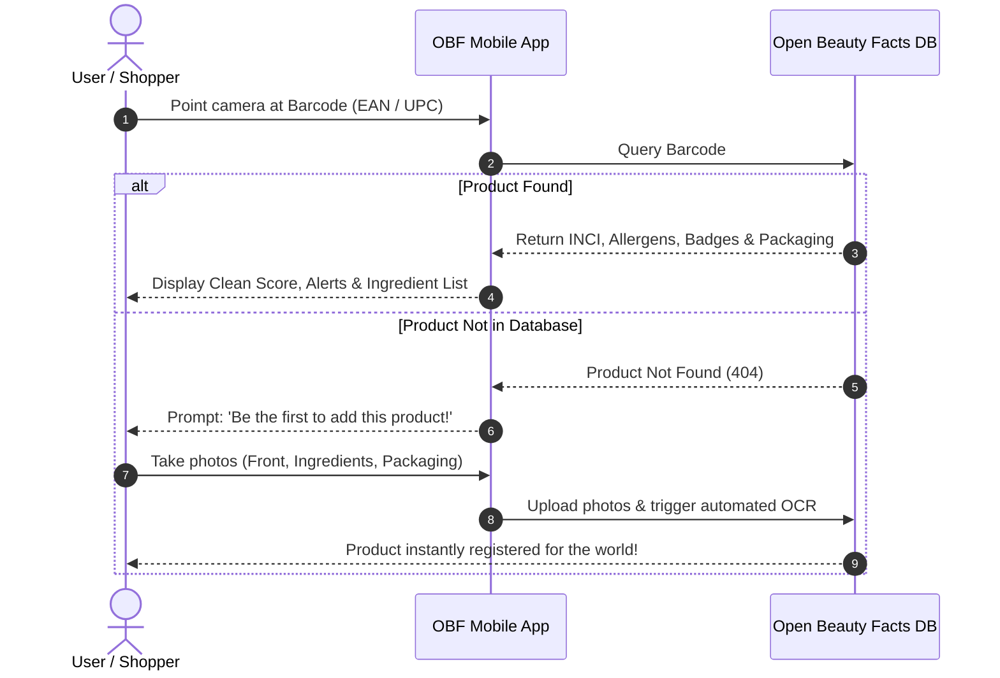
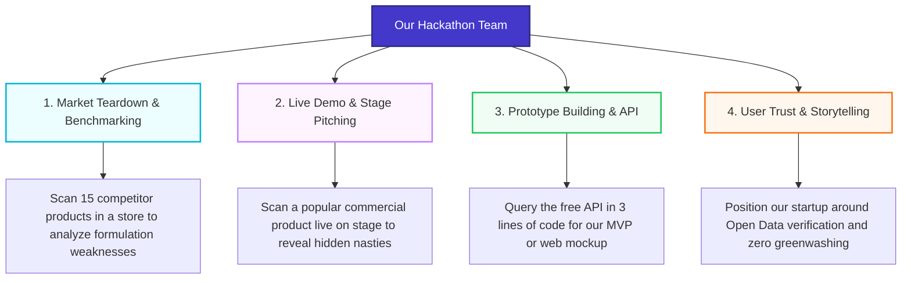

# Open Beauty Facts: The Ultimate Team Guide & Toolkit

> **Welcome Team!** This handbook explains what **Open Beauty Facts (OBF)** is, how its **Web Platform** and **Mobile App** work, and how we can leverage its tools and data during this hackathon.

---

## 1. What is Open Beauty Facts?

[Open Beauty Facts](https://world.openbeautyfacts.org/) is a free, non-profit, crowdsourced open database of cosmetic and personal care products worldwide. It is the direct sister project of **Open Food Facts** (the world's largest open food database).

* **Open Data (ODbL License):** Everything is freely accessible, queryable, and reusable by consumers, researchers, and startups.
* **100,000+ Products:** Cataloged across 170+ countries and expanding continuously.
* **Radical Transparency:** Decodes complex ingredient lists into standard **INCI** (*International Nomenclature of Cosmetic Ingredients*) formats, identifying allergens, controversial preservatives, and packaging materials.

### The Big Picture: How the Ecosystem Works

```mermaid
flowchart TD
    subgraph Inputs["1. Crowdsourced Inputs"]
        A["Shoppers & Volunteers"] -->|Take Photos & Scan Barcodes| B["Mobile App (iOS & Android)"]
        C["Brands & Community"] -->|Manual Entry & Imports| D["Web Portal"]
    end

    subgraph Engine["2. OBF Processing Engine"]
        B --> E["OCR Text Extraction"]
        D --> E
        E --> F["INCI Normalization & Parsing"]
        F --> G["Safety, Allergen & Scent Tagging"]
        F --> H["Packaging & Material Classification"]
    end

    subgraph Outputs["3. Free Open Outputs"]
        G & H --> I["Public Web Database"]
        G & H --> J["Mobile App Scanner"]
        G & H --> K["Free Public REST API"]
        G & H --> L["Open Data Dumps (JSON / CSV)"]
    end

    style Inputs fill:#f0f9ff,stroke:#0284c7,stroke-width:2px
    style Engine fill:#fefce8,stroke:#ca8a04,stroke-width:2px
    outputs fill:#f0fdf4,stroke:#16a34a,stroke-width:2px
```

---

## 2. Exploring the Web Platform (`world.openbeautyfacts.org`)

The website is a search engine, an investigative encyclopedia, and an open editing workbench for cosmetic products.



### Key Features on the Website:

1. **Deep Product Inspection:**
   * **Full INCI Breakdown:** Lists ingredients in descending order of concentration.
   * **Automated Risk Flags:** Highlights potential endocrine disruptors, sulfates (SLS/SLES), silicones, parabens, and microplastics.
   * **European Allergen Tracing:** Highlights the 26 mandatory declarable allergens (e.g., *Linalool, Limonene, Geraniol*).
   * **Packaging Materials:** Tracks containers (e.g., *PET plastic, Glass, Aluminium cap*) to monitor recyclability.

2. **Advanced Faceted Exploration:**
   * You can query products by specific attributes. Examples:
     * *“Show all shampoos without sulfates and without silicones.”*
     * *“Show all moisturizers certified with Ecocert.”*
     * *“List products by brand X to review their common additives.”*

3. **Open Contribution & Verification:**
   * Anyone can edit or improve product data directly in the browser.
   * If a product has missing ingredients, you can upload clear photos; the built-in OCR scans the text, crops the label, and suggests INCI matches.

---

## 3. The Mobile App (iOS & Android)

The mobile app is designed for **real-world, in-store interaction**. It turns any smartphone into an instant cosmetic label auditor.

### The Mobile App User Flow



### What You Can Do with the Mobile App:
* **Instant Barcode Scanning:** Scan cosmetic items at supermarkets, pharmacies, or at home in less than a second.
* **Spot Controversial Substances Instantly:** Color-coded warnings highlight substances flagged by consumer watchdogs.
* **Offline / Crowdsourcing Mode:** If you discover unlisted products, snap three photos (front label, ingredient list, barcode). The backend extracts the data automatically.
* **Personalized Product History:** Keep track of scanned items to review routines and comparisons later.

---

## 4. What Can Our Team Do with These Tools in the Hackathon?

Here are concrete ways our team can utilize the Web and App during the hackathon:



### 1. Competitive Formulation Audits (Market Research)
* **Action:** Go to a local store or bathroom cabinet, open the OBF app, and scan the top 10 market leaders in our chosen category (e.g., face creams, deodorants, shampoos).
* **Deliverable for Pitch:** A slide comparing:
  * *Competitor A:* 32 ingredients, 3 synthetic preservatives, non-recyclable composite bottle.
  * *Our Solution:* Clean, minimal, transparent, and sustainable.

### 2. Live Pitch Demo (High Audience Impact)
* **Action:** Bring a popular drugstore product onto the stage.
* **Demo:** Scan its barcode using the OBF mobile app or live web search.
* **Impact:** Show the audience the red-flagged substances on screen, proving with objective third-party open data why our startup's alternative is needed.

### 3. Rapid Prototype / MVP with the Free API
* No API keys, no approval delays, and no payment gateways.
* You can fetch product data in any language or No-Code tool with a single `GET` request:
  ```text
  GET https://world.openbeautyfacts.org/api/v0/product/{barcode}.json
  ```
* **MVP Ideas:**
  * **Dupe Finder:** Find cheap alternatives with matching active ingredients.
  * **Allergy Checker:** Profile-based alert system for sensitive skin or pregnant women.
  * **Greenwashing Buster:** Calculate the ratio of plant extracts vs petroleum derivatives.

### 4. Radical Transparency & Trust Badge
* If our startup makes or curates physical products, we can register them on Open Beauty Facts.
* **Value Proposition:** *"We are so confident in our ingredients that our products are registered on Open Beauty Facts for public scrutiny."*

---

## 5. Quick Comparison: Web vs. Mobile App

| Feature | 🌐 Web Platform (`world.openbeautyfacts.org`) | 📱 Mobile App (iOS / Android) |
| :--- | :--- | :--- |
| **Primary Use Case** | Deep research, batch search, data editing | Fast in-store scanning and on-the-go checks |
| **Input Method** | Text search, barcode input, category filters | Camera barcode scanner & photo snapping |
| **Ingredient Analysis** | Detailed chemical/botanical breakdown | Visual summary alerts and flags |
| **Contribution** | Full manual editor, label cropping, tag reviews | Fast photo upload (crowdsourcing on the fly) |
| **Exporting Data** | Direct JSON/CSV dumps available | Individual product sharing |
| **Best For Hackathon** | Market analysis, slides data, API testing | Live stage demonstrations and competitor audits |

---

## 6. Useful Links & Resources

* 🌍 **Web Portal:** [world.openbeautyfacts.org](https://world.openbeautyfacts.org/)
* 📱 **Android App:** [Google Play Store](https://play.google.com/store/apps/details?id=org.openbeautyfacts.scanner)
* 🍏 **iOS App:** [Apple App Store](https://apps.apple.com/app/open-beauty-facts/id1122926380)
* 💻 **Developer API Docs:** [Open Food/Beauty Facts API Reference](https://openfoodfacts.github.io/api-documentation/)
* 📦 **Sample API Query:**
  ```bash
  curl -s "https://world.openbeautyfacts.org/api/v0/product/3017620422003.json"
  ```
