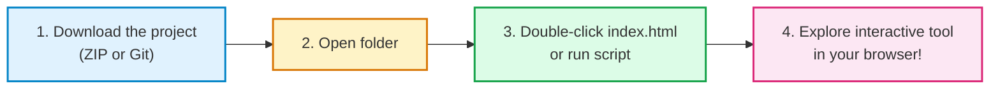
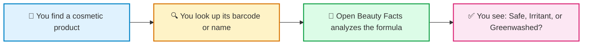

# 💄 Open Beauty Facts — Market Intelligence & Cosmetic Data Platform (ESCP-42)

> **Welcome to the ESCP-42 project!**  
> This project is a **ready-to-use visual exploration tool** and **business guide** powered by [Open Beauty Facts](https://world.openbeautyfacts.org/). Designed for business students, entrepreneurs, and researchers, it helps you uncover cosmetic market statistics, expose misleading marketing (*greenwashing*), and analyze verified ingredient data—**without needing any technical background**.

---

## 📑 Table of Contents

1. [🚀 Quick Start: How to Open and View the Web Page](#-quick-start-how-to-open-and-view-the-web-page)
   * [Method 1: The Easiest Way (Double-click, no installation needed)](#method-1-the-easiest-way-double-click-no-installation-needed)
   * [Method 2: Using the automated helper script](#method-2-using-the-automated-helper-script)
   * [How to close everything when you are done](#how-to-close-everything-when-you-are-done)
2. [✨ What is Open Beauty Facts? (The 10-Second Guide)](#-what-is-open-beauty-facts-the-10-second-guide)
   * [The "Wikipedia of Cosmetics"](#the-wikipedia-of-cosmetics)
   * [What the label says vs. What Open Beauty Facts tells you](#what-the-label-says-vs-what-open-beauty-facts-tells-you)
3. [💡 Startup Business Ideas & Market Opportunities](#-startup-business-ideas--market-opportunities)
   * [High-potential business models](#high-potential-business-models)
   * [Market Opportunity Matrix (Impact & Revenue)](#market-opportunity-matrix-impact--revenue)
4. [🖥️ What's Inside the Interactive Web Tool (`landing_page`)](#️-whats-inside-the-interactive-web-tool-landing_page)
5. [📁 Project Files Overview](#-project-files-overview)
6. [🔗 Useful Links](#-useful-links)

---

## 🚀 Quick Start: How to Open and View the Web Page

You do not need to install complicated software or know how to code. Follow these simple steps:



### Step 1: Download the project

Choose whichever is easier for you:

* **Option A (No commands — Recommended):**
  1. Go to the project page on GitHub: [https://github.com/CarlosJX7/ESCP-42](https://github.com/CarlosJX7/ESCP-42).
  2. Click the green **`<> Code`** button near the top right.
  3. Click **"Download ZIP"**.
  4. Once downloaded, right-click the file and choose **"Extract All"** (or unzip).
* **Option B (With Git):**
  1. Open your terminal or command prompt.
  2. Type `git clone https://github.com/CarlosJX7/ESCP-42.git` and press `Enter`.
  3. Type `cd ESCP-42` and press `Enter`.

---

### Step 2: Open and view the web tool

#### 🌟 Method 1: The Easiest Way (Double-click, no installation needed)
1. Open the extracted **`ESCP-42`** folder.
2. Open the **`landing_page`** folder.
3. Double-click the file named **`index.html`**.
4. That's it! The tool will immediately open in your regular web browser (Chrome, Safari, Edge, Firefox).

#### ⚙️ Method 2: Using the automated helper script
If you prefer running a local server:
* **On Mac or Linux:** Open your terminal in the project folder and type:
  ```bash
  ./script.sh
  ```
  *(or `bash script.sh`)*.
* **On Windows:**
  ```cmd
  python -m http.server 8000 --directory landing_page
  ```
Then open your browser and go to: **[http://localhost:8000](http://localhost:8000)**.

---

### How to close everything when you are done

* **If you used Method 1 (double-click):** Simply close the browser tab.
* **If you used Method 2 (script/server):** Click on the terminal window, press **`Ctrl + C`** on your keyboard to turn off the server, and close your browser tab.

---

## ✨ What is Open Beauty Facts? (The 10-Second Guide)

### The "Wikipedia of Cosmetics"

Most beauty and hygiene labels are written in tiny, confusing chemical terms. 

[Open Beauty Facts](https://world.openbeautyfacts.org/) is a free, non-profit, worldwide public database where thousands of contributors catalog cosmetic products to reveal **what is truly inside them**.
* It catalogs **over 100,000 personal care products** from 170+ countries.
* Everything is 100% public, open, and free to explore.



---

### What the label says vs. What Open Beauty Facts tells you

Instead of guessing what Latin chemical names mean, Open Beauty Facts translates them into everyday language:

| What you see on the packaging | What it actually means in plain English |
| :--- | :--- |
| **"Aqua, Sodium Laureth Sulfate..."** | ⚠️ Contains harsh foaming agents that can dry out and irritate sensitive skin. |
| **"Parfum / Fragrance"** | ⚠️ Contains hidden synthetic scent allergens that can cause rashes and eczema. |
| **"100% Herbal & Botanical!"** | 🛑 **Greenwashing alert!** The plant extract is less than 0.1% near the bottom of the formula; the rest is petroleum wax. |
| **Shiny plastic bottle** | ♻️ Tells you whether the container can truly be recycled or if it goes straight to a landfill. |

---

## 💡 Startup Business Ideas & Market Opportunities

### High-potential business models

1. 🌿 **"The Dupe Finder" (Smart Alternative Matcher):**  
   * **Problem:** Luxury skincare products cost €90+ mainly due to celebrity marketing and heavy packaging.  
   * **Solution:** A smart comparison tool that finds affordable €8 drugstore products with almost identical active ingredients.  
   * **Revenue:** Affiliate commissions when users purchase recommended alternatives.

2. 🛡️ **"Allergy & Skin Guardian" (Personalized Safety Checker):**  
   * **Problem:** People with eczema, acne, or allergies struggle to read microscopic labels.  
   * **Solution:** Users save their skin profile once; looking up any product gives a direct **Safe / Avoid** verdict.  
   * **Revenue:** Freemium subscription model.

3. 🛑 **"Greenwashing Buster" (Truth in Marketing):**  
   * **Problem:** Big brands advertise "Pure Aloe" or "Argan Miracle" when the plant extract is less than 0.1% of the bottle.  
   * **Solution:** An audit score calculating the gap between marketing claims and actual formula reality.  
   * **Revenue:** Brand verification badges and market transparency reports.

4. 🤖 **"Smart Skincare Advisor" (Interactive Beauty Assistant):**  
   * **Problem:** Consumers don't know which products match their unique routine and budget.  
   * **Solution:** A digital advisory tool that recommends the best products based on 100,000+ real formulas.  
   * **Revenue:** Premium personalized consultations and brand partnerships.

---

### Market Opportunity Matrix (Impact & Revenue)

| Business Concept | Ease of Launch | Market Demand | How It Generates Revenue |
| :--- | :--- | :--- | :--- |
| **Dupe Finder** | ⭐⭐⭐ High | 🔥 Very High (High consumer viral interest) | Affiliate sales commissions |
| **Allergy Guardian** | ⭐⭐⭐ High | ⭐ High (Solves real health pain) | Monthly subscription |
| **Greenwashing Buster** | ⭐⭐⭐ High | 🔥 Very High (High consumer awareness) | Brand audits & certifications |
| **Smart Skincare Advisor** | ⭐⭐ Medium | 🚀 Outstanding (High engagement) | Premium consultations & partnerships |

---

## 🖥️ What's Inside the Interactive Web Tool (`landing_page`)

The **`landing_page`** folder contains an interactive web application to explore cosmetic data:

* 🇪🇸 / 🇬🇧 **Bilingual (English & Spanish):** Switch languages with one click at the top.
* 📊 **Macro Industry Metrics Bar:** Eye-opening stats on petroleum fillers, fragrance allergens, and single-use packaging.
* 🧴 **Brand Chemical Teardown (Demo #1):** Compare Dove, L'Oréal, and Nivea directly against a 100% clean botanical formulation.
* 🛑 **Greenwashing Calculator (Demo #2):** Demonstrates how brands mislead customers when advertised botanicals are listed at the very bottom of the formula.
* 📋 **Market Problem Fact Cards (Demo #3):** Key industry statistics, chemical exposure figures, and consumer demand metrics.
* 🔍 **Live Barcode Lookup (Demo #4):** Enter real cosmetic barcodes to fetch live product info directly from the global database.

---

## 📁 Project Files Overview

```text
ESCP-42/
├── README.md                          # Main project guide (this document)
├── script.sh                          # Helper script to launch the local web server
├── SIMPLE_GUIDE_OPEN_BEAUTY_FACTS.md  # Plain-English handbook for team members
├── OPEN_BEAUTY_FACTS_OVERVIEW.md      # Detailed reference guide on Open Beauty Facts
├── OPEN_BEAUTY_FACTS.md               # Deep dive into business models & market opportunities
└── landing_page/                      # The interactive web application
    ├── index.html                     # Visual web interface
    ├── app.js                         # Interactive demos & calculations
    └── README.md                      # Overview of the web application
```

---

## 🔗 Useful Links

* 🌍 **Open Beauty Facts Website:** [world.openbeautyfacts.org](https://world.openbeautyfacts.org/)
* 📦 **Project Repository:** [github.com/CarlosJX7/ESCP-42](https://github.com/CarlosJX7/ESCP-42)

---

*Created for the ESCP-42 Project.*
