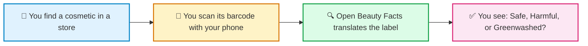
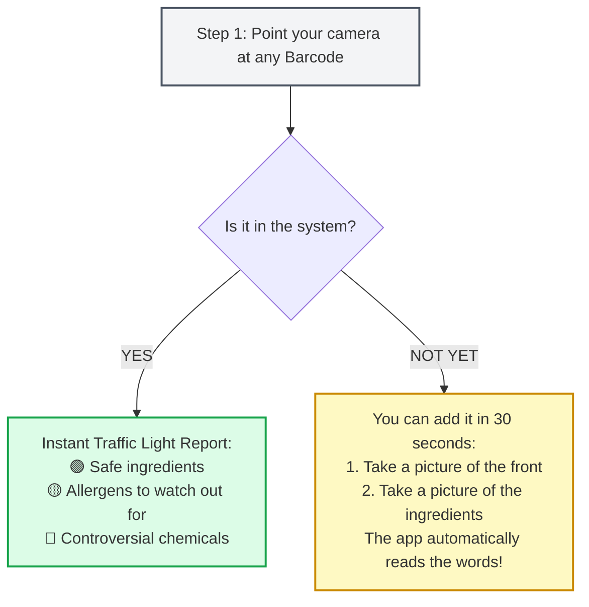
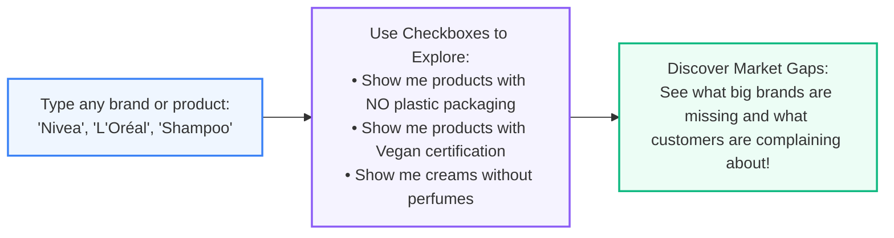
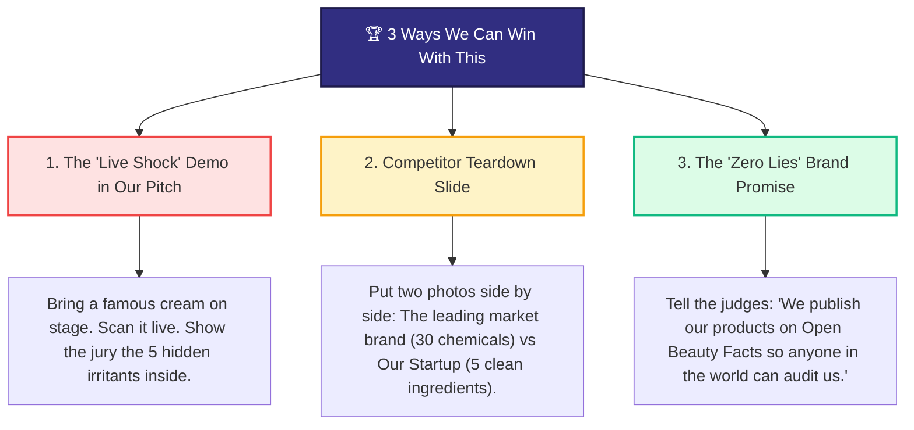

# What is Open Beauty Facts? (A Simple Guide for Our Team)

> **No tech jargon here!** This guide is made for everyone on our team (marketing, business, design, and ideas) to understand what Open Beauty Facts is, how to use it with your phone, and how it can help us stand out in the hackathon.

---

## 1. The 10-Second Explanation

Think of **Open Beauty Facts** as the **"Wikipedia of Cosmetics"**.

* When you buy a cream, shampoo, or perfume, the ingredient label looks like alien Latin.
* **Open Beauty Facts** is a free public website and mobile app made by thousands of regular people around the world who photograph and scan cosmetics to reveal **what is truly inside them**.
* It is 100% free, run by a non-profit community, and has analyzed over **100,000 products** from all over the world.

---

## 2. What Does It Actually Tell You?

Instead of reading tiny chemical words, the tool highlights the things normal consumers care about:

| What you see on the box | What Open Beauty Facts tells you in plain language |
| :--- | :--- |
| **"Aqua, Sodium Laureth Sulfate..."** | ⚠️ Contains harsh drying foaming agents (sulfates). |
| **"Parfum / Fragrance"** | ⚠️ Contains hidden fragrance allergens that can trigger skin rashes. |
| **"100% Herbal & Natural!"** | 🛑 **Greenwashing alert!** The plant extract is only 0.1% at the bottom, and the rest is petroleum wax. |
| **Plastic packaging** | ♻️ Tells you if the container can actually be recycled or if it goes straight to a landfill. |

---

## 3. How the Mobile App Works (In 3 Simple Steps)

You don't need any training. Download the free app on iPhone or Android, and you are ready to go:

* **Where you can use it:** In your bathroom, at Sephora, at the supermarket, or in a local pharmacy.
* **Why it feels like magic:** You immediately see what large beauty brands hide behind clever marketing slogans.

---

## 4. How the Website Works (`world.openbeautyfacts.org`)

The website is a **super-search engine** for cosmetics. Anyone can visit it on a laptop without creating an account:

---

## 5. How Our Team Can Use This to Win the Hackathon

We don't need to write a single line of software code to make our project look brilliant. Here are 3 non-technical ways we can use this:

### 1. The "Live Shock" Demo on Stage (High Drama for the Pitch)
* Walk up to the judges with a very popular, expensive brand (e.g., a luxury moisturizing cream).
* Pull out your phone and scan the barcode.
* Show the screen to the jury: *"This cream costs €60, but Open Beauty Facts reveals it contains petroleum derivatives, artificial perfumes, and non-recyclable plastic. That is why our startup exists."*

### 2. The Competitor Comparison Slide (Visual Proof for Investors)
* In our slide deck, make a visual table:
  * **Column A (The Industry Giant):** 35 ingredients, red warning badges, confusing chemical names.
  * **Column B (Our Startup):** 5 natural ingredients, 100% recyclable glass, zero asterisks.
* Mention that the data comes from an independent, non-profit database, which gives our startup **instant credibility**.

### 3. Finding an Unmet Customer Need (Business Idea Generation)
* Use the website to search for your favorite product category (e.g., baby shampoo or deodorant).
* Notice what people are missing (e.g., *"Almost all commercial deodorants have aluminum salts and plastic roll-ons"*).
* Build our startup's pitch around solving that specific gap!

---

## 6. Summary Cheat Sheet for the Team

| Question | Simple Answer |
| :--- | :--- |
| **Is it free?** | Yes, 100% free for everyone. |
| **Do we need to know programming?** | **No.** Just use the app with your phone camera or browse the website. |
| **Who created it?** | A global community of volunteers who believe consumers deserve honesty. |
| **What is our team's main takeaway?** | It is our secret weapon to prove with real evidence that today's beauty products have problems that our startup can solve. |

---

## 7. Try It Right Now! (2-Minute Test)

1. Open your bathroom cabinet and grab a shampoo, deodorant, or moisturizer.
2. Go to [world.openbeautyfacts.org](https://world.openbeautyfacts.org/) on your phone or computer.
3. Type the product name in the search bar.
4. Read what's really inside it, and share what you discovered with the team!
